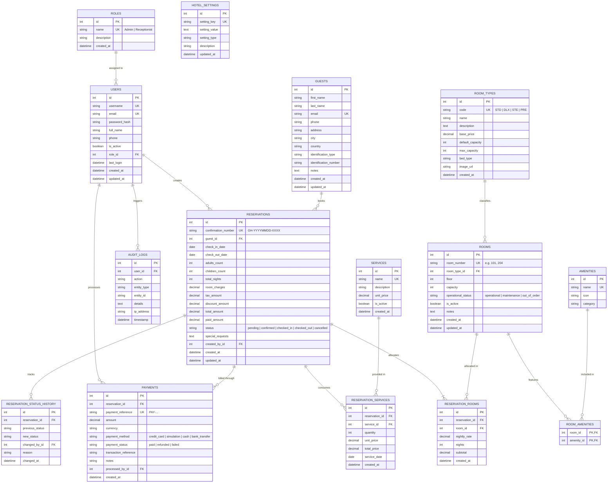

# SUPERSEDED — See [Verified Actual 3NF Model](actual_3nf_model.md)

This earlier diagram includes persisted aggregate fields removed by the verified normalization implementation. Use the ER model and relational schema in `actual_3nf_model.md` for the revised application schema.

# Grand Haven Hotel — Entity Relationship (ER) Diagram & Data Model (archived draft)
## ADBMS Phase I — Advanced Conceptual & Logical Data Modelling

This document details the conceptual and logical database design for the **Grand Haven Hotel — Hotel Reservation Management System**.

---

## 1. Renderable Mermaid ER Diagram

---

## 2. Cardinality Analysis & Relationship Semantics

| Parent Entity | Child Entity | Cardinality | Business Meaning / Integrity Constraint |
| :--- | :--- | :--- | :--- |
| **ROLES** | **USERS** | `1 : N` (One-to-Many) | Each staff member has exactly one role clearance. A role can be assigned to zero, one, or many staff. `ON DELETE RESTRICT`. |
| **GUESTS** | **RESERVATIONS** | `1 : N` (One-to-Many) | A registered guest may place multiple reservations across time. A reservation belongs to exactly one primary guest. `ON DELETE RESTRICT`. |
| **ROOM_TYPES** | **ROOMS** | `1 : N` (One-to-Many) | A suite classification (e.g., Deluxe Oceanfront) governs multiple physical room units. Deleting a type with active rooms is disallowed. `ON DELETE RESTRICT`. |
| **ROOMS** | **AMENITIES** | `M : N` (Many-to-Many) | Resolved via junction entity `ROOM_AMENITIES`. A room features multiple amenities; an amenity is featured across multiple rooms. |
| **RESERVATIONS** | **ROOMS** | `M : N` (Many-to-Many) | Resolved via junction entity `RESERVATION_ROOMS`. Preserves historical rate snapshots (`nightly_rate`, `subtotal`). Unique constraint `(reservation_id, room_id)`. |
| **RESERVATIONS** | **PAYMENTS** | `1 : N` (One-to-Many) | Multiple transaction records (deposit, final balance, refunds) associate to one reservation. `ON DELETE RESTRICT`. |
| **RESERVATIONS** | **SERVICES** | `M : N` (Many-to-Many) | Resolved via junction entity `RESERVATION_SERVICES` with quantity and unit price. |
| **RESERVATIONS** | **STATUS_HISTORY** | `1 : N` (One-to-Many) | Chronological state transition audit log (`pending` -> `confirmed` -> `checked_in` -> `checked_out`). Cascade deleted if reservation is purged. |
| **USERS** | **AUDIT_LOGS** | `1 : N` (One-to-Many) | Security and operations audit trail. `ON DELETE SET NULL` ensures logs are preserved even if staff account is deleted. |

---

## 3. Entity Integrity & Domain Constraints

1. **Monetary Precision**: All monetary values (`base_price`, `nightly_rate`, `room_charges`, `tax_amount`, `discount_amount`, `total_amount`, `paid_amount`, `amount`, `unit_price`, `total_price`) utilize fixed-point `DECIMAL(10, 2)` representations to eliminate floating-point rounding errors.
2. **Temporal Bounds**: Check constraint `chk_res_dates` strictly requires `check_out_date > check_in_date`.
3. **Double Booking Guard**: Checked via composite unique indexing and database triggers (`trg_prevent_double_booking`) preventing overlapping date ranges for active allocations.
